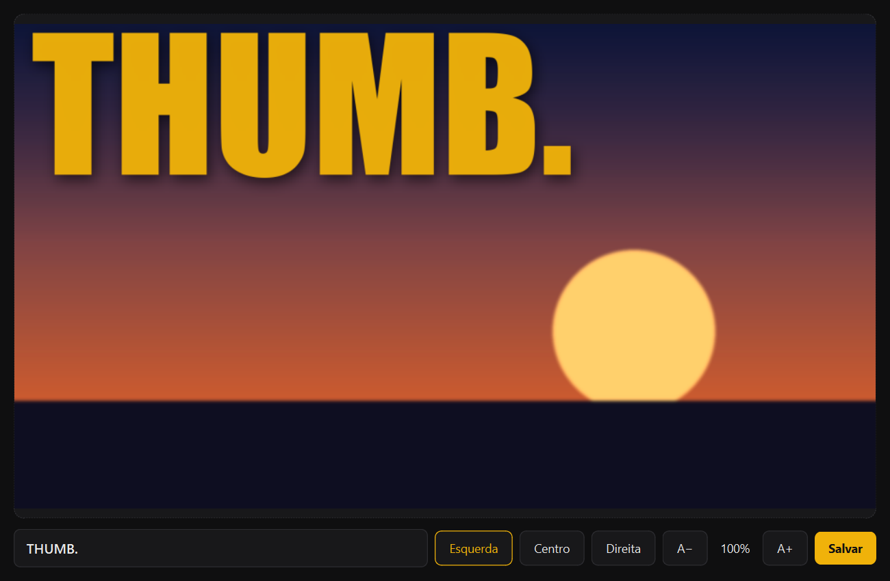

<p align="center">
  
</p>

<h1 align="center">ThumbYT</h1>

<p align="center">
  YouTube thumbnails in seconds: drop an image, type the word, save. One big yellow word with a period at the top, always in the same style.
</p>

<p align="center"><b>English</b> · <a href="README.pt-BR.md">Português</a></p>

<p align="center">
  
  
  
  
</p>

<p align="center">
  
</p>

> [!NOTE]
> **Fully local.** Your image never leaves your computer: no account, no upload, no network requests.

## Features

- **Drag and drop** an image onto the window, or click the preview to open one (`Ctrl+O`). PNG, JPEG, WebP and BMP, any aspect ratio: the image is center-cropped to 16:9.
- **Live preview** while you type, showing the final result.
- **Alignment**: left, center or right.
- **Text size** from 30% to 200% with **A−** and **A+** (`Ctrl+-` and `Ctrl+=`). At 100% the word is as large as it can be while still fitting.
- **Save** as PNG or JPEG, 1920×1080 (`Ctrl+S`). The suggested name is the original name plus `_thumb.png` (`sunset.jpg` → `sunset_thumb.png`), in the same folder.
- **Command line** to generate without opening the window, handy for scripts.

## Getting started

Requires Python 3.9 or newer.

```sh
pip install PySide6 pillow
python app.py
```

From the command line:

```sh
python thumb.py image.png "WORD." output.png [esquerda|centro|direita]
```

The alignment argument is in Portuguese: `esquerda` (left, default), `centro` (center), `direita` (right).

### Font

The look is designed for **Inter Display Black**. Download it from [rsms.me/inter](https://rsms.me/inter/) and put `InterDisplay-Black.otf` in the project folder. Without it, the app falls back to Windows' **Impact**.

## How it works

```
image  →  16:9 crop + 1920×1080  →  +15% color, +8% contrast  →  dark gradient at the top
       →  yellow word with soft shadow  →  PNG / JPEG
```

- **Automatic size**: the font starts at 400 px and shrinks until the word fits the width (40 px margin) and 30% of the height. Your scale is applied after that.
- **Fast preview**: the background is prepared once and cached; on each keystroke only the text is redrawn, 120 ms after you stop typing.
- **Icon**: drawn by the code itself at startup, no image file needed.

### Layout

```
app.py          window (PySide6): preview, controls, shortcuts and icon
thumb.py        rendering (Pillow) and command line
test_thumb.py   quick test: python test_thumb.py
```

## Known limitations

- **Above 100% the text can go past the edge.** That is on purpose, and the preview shows it before you save.
- The text is always **at the top**. The vertical position is not adjustable.
- Color, font and shadow are fixed in the code (`thumb.py`).
- The interface is in Portuguese.

## Credits

- Font: [Inter](https://rsms.me/inter/) by Rasmus Andersson (SIL Open Font License).
- UI: [Qt for Python (PySide6)](https://doc.qt.io/qtforpython-6/). Imaging: [Pillow](https://python-pillow.org).
