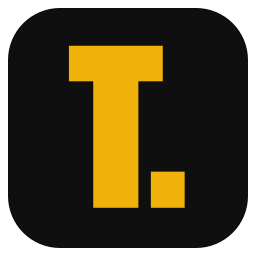
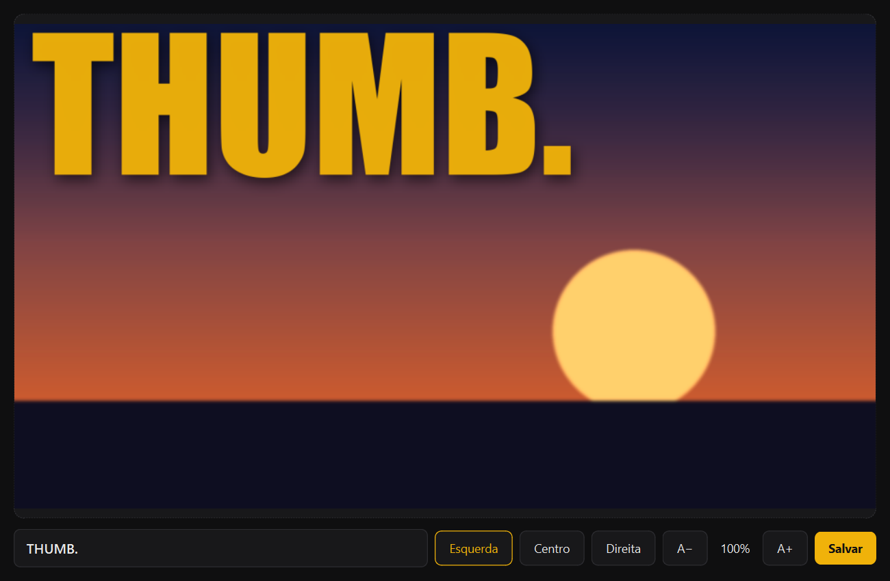

<p align="center">
  
</p>

<h1 align="center">ThumbYT</h1>

<p align="center">
  Thumbnails para o YouTube em segundos: arraste uma imagem, digite a palavra, salve. Uma palavra grande, amarela e com ponto final no topo, sempre no mesmo estilo.
</p>

<p align="center"><a href="README.md">English</a> · <b>Português</b></p>

<p align="center">
  
  
  
  
</p>

<p align="center">
  
</p>

> [!NOTE]
> **Tudo local.** A imagem nunca sai do seu computador: nada de conta, upload ou requisição de rede.

## Funcionalidades

- **Arrastar e soltar** uma imagem na janela, ou clicar na prévia para abrir (`Ctrl+O`). Aceita PNG, JPEG, WebP e BMP, em qualquer proporção: a imagem é recortada no centro para 16:9.
- **Prévia ao vivo** enquanto você digita, já no resultado final.
- **Alinhamento** à esquerda, ao centro ou à direita.
- **Tamanho do texto** de 30% a 200% com **A−** e **A+** (`Ctrl+-` e `Ctrl+=`). Em 100% a palavra fica no maior tamanho que cabe sozinha.
- **Salvar** em PNG ou JPEG, 1920×1080 (`Ctrl+S`). O nome sugerido é `imagem_thumb.png`, na pasta da imagem original.
- **Linha de comando** para gerar sem abrir a janela, útil em scripts.

## Começando

Requer Python 3.9 ou mais novo.

```sh
pip install PySide6 pillow
python app.py
```

Pela linha de comando:

```sh
python thumb.py imagem.png "PALAVRA." saida.png [esquerda|centro|direita]
```

### Fonte

O visual foi pensado para a **Inter Display Black**. Baixe em [rsms.me/inter](https://rsms.me/inter/) e coloque `InterDisplay-Black.otf` na pasta do projeto. Sem ela, o app usa a **Impact** do Windows.

## Como funciona

```
imagem  →  recorte 16:9 + 1920×1080  →  +15% cor, +8% contraste  →  degradê escuro no topo
        →  palavra amarela com sombra difusa  →  PNG / JPEG
```

- **Tamanho automático**: a fonte começa em 400 px e diminui até a palavra caber na largura (margem de 40 px) e em 30% da altura. A escala do usuário é aplicada depois disso.
- **Prévia rápida**: a imagem de fundo é preparada uma vez e guardada; a cada tecla só o texto é desenhado de novo, 120 ms depois que você para de digitar.
- **Ícone**: desenhado pelo próprio código ao abrir, sem arquivo de imagem.

### Estrutura

```
app.py          janela (PySide6): prévia, controles, atalhos e ícone
thumb.py        renderização (Pillow) e linha de comando
test_thumb.py   teste rápido: python test_thumb.py
```

## Limitações conhecidas

- **Acima de 100% o texto pode passar da borda.** É de propósito, e a prévia mostra antes de salvar.
- O texto fica sempre **no topo**. A posição vertical não é ajustável.
- Cor, fonte e sombra são fixas no código (`thumb.py`).

## Créditos

- Fonte: [Inter](https://rsms.me/inter/) por Rasmus Andersson (SIL Open Font License).
- Interface: [Qt for Python (PySide6)](https://doc.qt.io/qtforpython-6/). Imagem: [Pillow](https://python-pillow.org).
